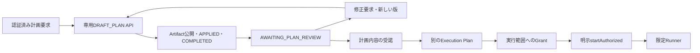

# COORD-5C-4B-2B: Bounded Continuation / Hold Lifecycle / Planning-only

基準mainは `e4de47b6f5290ec566e26c6a7ffd22ae1e82ab5a`。Schema **9**、Migration **009_bounded_continuation_hold_lifecycle**、Contract **COORD-5C-4B2B:BOUNDED_EXECUTION:1** を追加する。001〜008の生成SQL、既存のModel単回送信、Usage精算、Application Receipt、4B-1の解決証跡、2Aの単回Dispatch・F-01同期Timeout検査は維持する。

## 利用者の操作と権限

| Operation / Mode / Origin | 結果と許可範囲 |
| --- | --- |
| PLANNING_ONLY / THINK_ONLY / USER_REQUEST | 明示した入力だけで計画を作成。業務Task・Action・prepare・Read・Shellなし。正常Workflowの認証済み要求を保存し、その要求に限定したGrantを作る。Recovery Hold・復旧の追加承認は作らない |
| PLANNING_ONLY / PLAN_READ_ONLY / USER_REQUEST | 上記に加え、Hostが固定したローカル資料だけを専用Read Ledger経由で読む。書込み・業務Executor・SQL・ネットワークReadは許可しない |
| PLANNING_ONLY / 上記2 Mode / RECOVERY | Hold・未解決状態・Review・元Workflow予算の検査と、別の復旧承認が必要 |
| BOUNDED_CONTINUATION / BOUNDED_EXECUTE / RECOVERY | 既存Runnerで NEW_ROUND、RESUME_PREPARED、VERIFY_FINALIZED_RESULT の指定位置から有限回実行。終了してもHoldを解除しない |
| BOUNDED_CONTINUATION / BOUNDED_EXECUTE / USER_REQUEST | 受諾済みArtifactのID・版・Digestを固定し、新しい実行Plan・Grant・明示開始を要求 |
| RELEASE_RECOVERY_HOLD / Modeなし / RECOVERY | 別の解除承認に基づくDB内操作。Runner・Model・Executorを起動しない |

計画要求の入力版・Mode・認証済み要求・データ範囲は `recovery_continuation_plans.plan_json` に統合し、同一情報だけを持つ `planning_requests` 表を重複作成しない。Providerへ送る生Promptや読取り本文はModel Ledger/Auditへ保存しない。

`ContinuationPlan`は権限・予算・前提条件を固定する実行計画、`PlanArtifact`は利用者が読む検証済み成果物であり、同一物ではない。Artifactの `ACCEPTED_FOR_SCOPE` は実行許可ではない。



停止中Workflowを通常計画としてResumeすることは禁止する。検討には、認可済み・明示された入力Snapshotを **別の健全なWorkflow** に渡す。参照元の閲覧権・送信先の許可は検証するが、元Workflowの予算・権限・未解決Attemptをコピーしない。元Workflowを実行可能にするには、引き続き元のRecovery手続きが必要。

## Host設定とヘッドレスAPI

```ts
const database = new DurableDatabase({
  path,
  recoveryIdentityVerifier, // 信頼したHost実装。要求DTOの自己申告Roleは使わない
  controlledExecutors,     // 版・実装Digest・retry無効化を固定した既存Registry
  bounded: {
    policy: {
      version: 'host-policy:1',
      planningRoles: ['RECOVERY_OPERATOR'], // 既存の認証済みRoleからHostが明示対応
      recoveryApprovals: { minimumApprovers: 2, forbidSelfApproval: true },
      releaseApprovals: { minimumApprovers: 2, forbidSelfApproval: true },
      canAccess, canSend, inspectContent,
      isSnapshotCurrent, // 非ローカルSnapshotを実行へ採用する場合に必要
      storeReasoningSummary: false,
    },
    providers: trustedProviderRegistry,
    reads: createLocalPlanningReadRegistry({
      root: '/absolute/approved/reference-root', rootId: 'approved-docs',
      files: { architecture: 'architecture.txt' }, maxBytes: 64 * 1024,
    }),
  },
});
const planning = new PlanningCoordinator(database, lease);
const execution = new RecoveryContinuationCoordinator(database, lease);
const reader = new RecoveryContinuationReader(database);

planning.preview(request, credential); // read-only。準備不足理由を返す。権限を発行しない
const plan = planning.createPlan(request, credential);
const result = await planning.startAuthorized(plan.planId, credential, { signal });
reader.inspect(plan.planId, credential); // 同じArtifact・Usage・終了状態を読むだけ
reader.timeline(plan.planId, credential); // 最小Audit参照。生Prompt・本文を含まない
planning.recordReview(result.artifact!, 'ACCEPTED_FOR_SCOPE', credential, result.review.target!.controlRevision);
// 別に、具体的ActionのExecutor/Operation/分類/payloadDigestを固定する。
const approvedExecution = execution.createPlan(executionRequest, operatorCredential);
execution.authorize(approvedExecution, approverCredential);
// Host設定の必要人数分を承認した後でのみ開始する。
await execution.startAuthorized(approvedExecution.planId, operatorCredential);
```

`requestRevision(artifactRef, newRequest, credential)` は原本を変更せず、前版参照を持つ新しい版を生成する。同一版の分岐した後継は一意制約で防ぐ。修正の開始や入力待ち・失敗・取消・Timeoutでは旧計画の未解決Review Gateを保持し、完成した新版の保存時だけ原子的に対象を置き換える。採用時とAction登録・送信直前に参照資料を再検証する。

レビュー対象は追記専用のArtifact公開・Review履歴と有効Controlから導出し、現在のArtifact ID・Version・Digest・Owner・Control Revisionを結び付ける。`review.target` は照会したArtifactが現在対象で、操作者がOwnerの場合だけ返す。`recordReview(ref, decision, credential, expectedControlRevision)` の第4引数は必須。同じTransactionで現在対象と期待Revisionを検査し、ReviewとControlを更新する。古い対象やRevisionの再送は書込みなしで拒否する。現在対象の拒否・置換はGateを解除し、受諾はGateを保持してRevisionを進める。受諾は実行Grantを作らない。別の計画が待っているときに旧Artifactを修正・実行計画の参照として使うことも拒否する。

実行可能な合成シナリオは `test/coordination-planning-only-adoption.test.ts`、`test/coordination-recovery-continuation.test.ts`、`test/coordination-hold-lifecycle.test.ts` にある。APIキー不要で、Plan提示→内容確認→別承認→1 Round、独立Snapshot計画、VERIFYのみ、解除を自動検証する。既存UIへの本番Identity接続は含めない。

`ContinuationInspection` はMode、Artifact、参照、要約状態、確定／未確定Usage、回数、残枠、実施したModel・Read・Action、終了理由、内容レビュー状態を返す。`internalPersistence: true` はModel課金やMAP内部保存と「業務変更なし」を区別する。`executionAllowed` は常にfalseで、DTOを実行権限に転用できない。既存RecoveryReaderも現在のControlと計画レビュー待ちを表示し、過去Receiptの検証には変更されていないHold原本を使う。

`needs_input` は `inputRequest` に検証済み質問・Digest・出所を返す。`inputRequest.state` は `AWAITING_INPUT`、Invocationは `STOPPED / PLAN_INCOMPLETE` で、完成したPlanの `AWAITING_PLAN_REVIEW` とは区別する。初回 `startAuthorized()` と認証付きReader／再接続は同じ保存済み質問を返す。質問の所有者本人かつ現在のWorkflow閲覧ACLを満たす必要があり、別Actorの管理者Roleだけでは取得できない。回答は新しいrequestId・明示入力・予算のPlanとして作成し、表示や再照会からModelを再生成しない。

既存Artifactの修正中に質問待ちになった場合は、そのArtifactのレビュー待ちを保持する。回答を渡す次の要求も現在対象への `requestRevision` とし、元のArtifactを参照する。元の計画をレビューする場合は認証付き再照会で最新のControl Revisionを取得する。

## 原子的な開始・Step・保存

開始TransactionはIdentity・Role・Lease、全Plan Binding、二重Budget、Review、排他を再検証し、Grant消費・必要な単一Resume・Invocation・Control Lifecycle・Receipt・Auditを同時確定する。SQLiteの部分一意Indexにより、WorkflowごとのACTIVE/DRAININGは最大1件。Plan・Grant自身の保存やHeartbeatはBindingを失効させず、Generation、Policy、対象、Budget、Resource、Adapter版・実装変更は失効させる。

PLANNING_ONLYの開始者は、OriginにかかわらずPlan作成者本人を要求する。管理者Roleだけで代理開始できない。読取りだけの再送経路でも本人を検査し、開始TransactionでもGrant消費・Resume・Invocation作成・モデル予約より前に再検査する。USER_REQUESTのplanningRoles、RECOVERYのOperator/Admin、ACL・Lease・承認の検査は別途維持する。これによりPlan作成者・Invocation本人・質問Ownerが一致する。質問Readerの所有者検査と、BOUNDED_CONTINUATION等の既存開始権限は変更しない。

開始COMMITの正常returnを直接得た分岐だけが、DBインスタンスとGenerationに結び付く非公開Contextを持つ。開始ACK喪失、保存IDの再要求、別接続、別プロセス、DTO偽造から再生成しない。開始だけ確定して実行できなかったACTIVE行は診断対象として保全する。

Roundは開始位置確定時、ModelはReservation、ActionはDispatch Reservation、ReadはIntentと同じTransactionで `recovery_invocation_steps` / `recovery_invocation_debits` を追記する。ModelのIntent ACKを直接確認する前に送信しない。回数枠を取消・失敗で返却しない。Usage集計は元LedgerとDebitから読み出し、独立した可変残高を正本にしない。

Workflow committed + outstanding + requested と、Invocation committed + outstanding + requested の両方を検査する。安全整数、整数micro-USD、既存の保守的丸めを使う。元Workflowのwall time・連続Error等はリセットしない。上限超過Usageも事実として記録して以後の実行を止める。Unknown Usageは予約を残す。

業務Round Keyと新Callの一意キーを分け、StepにRound・Purpose・親Roundを保存する。既存Workflow/Round/Phaseの一意制約は維持する。置換は取消／破棄済みCallに限定し、旧Call・解決Audit/4B-1 ReceiptのDigest・新Callを `recovery_model_lineage` に同時記録する。Unknownや未適用本文を新IDで再発行しない。

外部Provider、Executor、prepare、Thenableの解決を含む非同期処理は、親Contextを外して呼ぶ。返却データもその範囲でJSONへ検証・分離する。Accessorや非JSONオブジェクトは拒否する。Executorに渡るEvidence Sinkは対象Action/Task/Session、現在Generation、件数・サイズ・実行deadlineを検査し、別のStepやWorkflowを操作できない。

Invocationの状態は ACTIVE → DRAINING → COMPLETED / STOPPED / REVIEW_REQUIRED。停止後の新しいVERIFYも禁止する。一方、開始済み対象のUsage・Result、対象限定Application、安全停止は回収窓内で保存できる。失われたLeaseからの保存は拒否する。実行中のみCoordinatorがHeartbeatを管理し、Open/ReaderはHeartbeatを開始しない。

`requestStop(planId, credential)` は有効Lease、現在の認証・Workflow閲覧ACLに加え、保存されたInvocationのOwner本人、または検証済み `RECOVERY_ADMIN` を要求する。PLAN/EXECUTEの可否から他者停止権限を推定しない。本人はPLAN/EXECUTEを撤回されても、認証と閲覧権限が有効なら停止できる。認可とDRAINING・STOP Receipt・Auditは同一Transaction。拒否やRollbackではDBもProvider Signalも変えない。ローカルAbortはCOMMIT後、親Scopeを外して通知する。COMMIT ACK喪失時は、その要求で観測した同じ不変Receiptを認証付きで再読取りできた場合だけ通知する。別接続のSTOPも応答回収・計画反映時に検査し、開始済みUsageを保存して新しいRead/ModelやArtifact公開を止める。

## 時間の上限

| Host上限兼既定値 | ms |
| --- | ---: |
| startTtlMs | 600000 |
| admissionMs | 300000 |
| modelTimeoutMs | 120000 |
| actionTimeoutMs | 30000 |
| readTimeoutMs | 5000 |
| collectionGraceMs | 30000 |
| finalizationMs | 30000 |

設定は正の安全整数で、初版では上表以下への短縮のみ。0、無期限、負数、NaN、Infinityは拒否する。本番向けの上限拡張はHost契約の見直しと再承認が必要。

開始期限はPlan作成DB時刻 + startTtlMs と作成者の認証期限の小さい方。Grant期限はPlan・承認者認証期限以下。受付期限は開始DB時刻 + admissionMs、Plan期限、開始者認証期限、消費Grant期限の最小値。各Stepのexecution deadlineは予約／Intent時刻 + 個別Timeout、collection deadlineはその値 + grace、application deadlineはさらに finalization。Invocation全体の保存上限は受付期限 + 最大個別Timeout + grace + finalization。

永続期限はDB時刻とSQL Triggerで検査し、外部呼出し直前に残時間を再検証する。応答採用・Evidence保存は単調時計で検査する。25ms上限に対する90msの同期ブロックでも遅延したタイマー通知を待って成功扱いしない。期限外本文は適用せず、完全Usageだけを回収窓内で精算する。回収窓外のUsageやUnknownをゼロにせず、固定の停止処理でREVIEW_REQUIREDにする。

## Artifactと安全なRead

DRAFT_PLANは業務 `RunnerPlanProposal` と別の `plan / read_requests / needs_input` 型。execute・Tool CallはTaskへ変換しない。最終出力の専用Artifact保存、PlanArtifactPublished Journal、APPLIED Receipt、COMPLETED/AWAITING_PLAN_REVIEW、ControlとAuditは同一COMMIT。ArtifactにはAPPLIED状態への遅延複合FKもある。途中の要求はPlanningReadRequested / PlanningInputRequested。これらのイベントはTask・Acceptance等の業務状態を変更しない。

質問は専用の `planning_input_requests` に保存する。20問以内・各4,096文字以内、保存JSONは128 KiB以内とし、Credential・秘密パターンとHostのData Class検査を適用する。質問保存、`PlanningInputRequested` の参照とDigest、Model APPLIED、Invocation終了、Receipt・Auditは同じCOMMIT。STRICT、追記専用Scope、Workflow/Invocation/ModelのFKとAPPLIEDへの遅延複合FKを持つ。Journal/Auditには質問本文やRaw Responseを入れない。保存失敗では確定済みUsageと未適用応答を保持し、質問・APPLIED・入力待ち終了だけの部分COMMITをしない。

本文は固定Schema、サイズ、Credential・秘密パターン、Host機密区分で検証し、専用表へ保存する。Model Ledger/Auditには生Prompt・Raw Response・隠されたReasoning・署名を保存しない。Summaryは別フィールドで AVAILABLE / NOT_REQUESTED / NOT_SUPPORTED / NOT_RETURNED / NOT_STORED と出所を示す。保存はHostの明示設定がある場合だけ。Artifact保存失敗時は既に確定したUsageを残し、PENDING_APPLICATIONを自動再Callしない。

LinuxのRead Registryは明示したRootと相対ファイルのallowlistだけを受け付ける。初期Digest・inode・device・mtime/ctime/sizeを固定し、descriptor相対open、O_NOFOLLOW、通常ファイル・hardlink数・UTF-8・サイズ検査を使う。traversal、別Root、symlink、UNC/ADS、Shell、自由SQL、URLを拒否する。読取り前後の同一性を検査し、内容は有限量の一時的なモデル入力にのみ渡す。Read LedgerはIntent、Resource、期待／結果Digest、状態、サイズ、deadline、費用0を保存する。本文をLedgerへコピーしない。

Artifact採用のSnapshot再検証は固定descriptorのメタデータ検査であり、追加の本文取得・Model送信ではない。非ローカルSnapshotはHostの `isSnapshotCurrent` がなければ採用を拒否する。ネットワークReadやWindows用の安全なReaderは未接続でFail Closed。

取得済みReadはResource ID・Digest・Revision・観測時刻とともに保持する。毎回の実Payloadを複製して固定し、入力本文・初回参照・累積Readについて現在のHost検査を予約前、Intent後の送信期限検査、親Scopeを外した外部呼出し直前に行う。`canSend` には現在の操作者・送信先・Data Classを渡し、取得時の許可を再利用しない。同じ入力集合をArtifactと質問の出所へ保存する。予約前の撤回では追加Model Debitを作らず、Intent後の撤回では送信を止めて既存の不確定予約を保持する。推測ゼロ精算や別IDへの再送は行わない。

最後のHost許可検査自体が同期的に遅延したり、その中で停止要求が発生しても、期限後・停止後の送信を開始しない。検査の後で現在Lease、ACTIVE状態、受付期限・Step送信期限、単調時計の送信期限、AbortSignalを再確認してからProviderへ入る。

## Hold・互換性・責務

`recovery_holds` 原本を更新・削除せず、追記専用LifecycleからControlを同一COMMITで投影する。holdEpoch、controlRevision、有効NONE/HELD/RELEASED、Active Invocation、Review Gateを持つ。投影・履歴の不一致は拒否する。通常Gate、SQL、Model/Action/Application、旧Recovery経路が同じ有効Controlを参照する。

解除には、Active/Draining・未知結果・予約・未適用応答・未反映Result・Budget違反・未解決Review・開いたSession・PREPARED・計画レビュー待ちがないことを要求する。正規Resumeが必要なら、元Referenceと仮適用後Snapshotの既存Guardを検証して一つだけ同時確定する。親GrantはAction/Security/Evidence Reviewの代わりにならない。Terminalを復活させない。

解除後は期限切れTakeoverだけでなく、正常Release→AcquireでもGeneration変更と同じCOMMITで新Epochへ再Holdする。HeartbeatはEpochを変えない。解除後に新たな安全停止を検出した場合も原本を保って再Holdする。旧4B-1/2A Receiptは当時の証跡で検証し、新PlanはEpoch/Revision sidecarへ固定する。Migration前の未消費権限はsidecar欠落により実行時に失効する。

元Action StepのApplication期限後は、旧Invocation・通常Store・無認可SQLのApplyを拒否する。別途認証・承認した4B-1 `REFLECT_RECORDED_RESULT` だけは、既存の非公開Safe Recovery Scopeに含まれる現在Lease、Plan/Grant、対象Workflow/Action、Attempt・Result参照/Digest、更新前後のLedgerとTaskイベントを照合して保存済みResultを反映できる。Triggerは既存の `map_safe_recovery_write` による正確な更新許可を検査する。期限を書き換えず、Grantを元Invocation権限へ転用せず、Executorを再実行しない。Grant消費・Task反映・FINALIZED・Receipt・Auditは元の4B-1 Transactionのまま。

Schema9は既存v8のHold・未解決状態を安全側へ投影する。OpenでInvocationを作らず、初回SeedとControlを同時確定する。既存SQLを生成する配列・定数は変更しない。実行前の旧RuntimeはSchema9を `SCHEMA_UNSUPPORTED` として拒否する。

| モジュール | 責務 |
| --- | --- |
| continuationTypes / continuationSchema | 共通契約、Schema9、Scope観測・状態遷移Trigger |
| recoveryContinuationPlanner / recoveryHoldLifecycle | 入力・Binding・開始可能性、共通Controlと旧権限検証 |
| recoveryContinuationCoordinator / boundedRunner | 固定公開Command、非公開進行Context、既存Runnerへの参加 |
| planningCoordinator / planningArtifactStore / planningReadRegistry | 有限回収、成果物検証、安全なローカルRead |
| recoveryContinuationReader / 既存RecoveryReader | 認証済みDTO・最小Audit Timeline、有効Control表示 |
| db / ModelCallLedger / ExecutionCoordinator / Evidence | 既存fenced transactionへ原子的に参加。公開APIからScopeを作らない |
| Kernel / Validation / planningEvents | 計画専用イベントの検証・Replay。業務状態を変更しない |

## 未接続範囲と4Cへの引継ぎ

Provider能力はProvider/Model/Adapter版・実装Digest、Purpose、許可された推論設定値、要約、完全Usage、推論を含む総出力上限、価格版、retry/tool無効化、Data Class・宛先を明示する。総出力に推論Tokenを含む正規化契約を要求し、要約Tokenで代用・二重加算しない。実際に適用する推論設定をArtifactに保存する。

このPRは合成Provider/Executorだけで検証する。GPT/Gemini/Claudeの本番Adapter、価格・課金・ストリーミング・opaque continuation blockの実装、Production Identity UIは未接続。既存テストAdapterを本番用として再Exportしていない。既定で利用可能なProviderはなく、必要な安全能力が不足すれば予約前に拒否する。Host Registry/ACL/Verifierは信頼境界であり、変更時は安定した版・Digest・Policy versionを更新する。

Unknown Action/Usage、Crash後の未送信か送信済みかを判定できないIntent、失われた本文は4C向けに保全する。自動再送・推測精算・無制限解除は提供しない。最新の検証結果は [F-04修正報告](coordination-pr35-owner-binding-correction.md)、レビュー・停止の認可境界は [RT-01/RT-02修正報告](coordination-pr35-redteam-corrections.md)、初回実装時の対応表は [検証報告](coordination-recovery-continuation-validation.md) を参照。

PR #35のF-01〜F-03修正と最新の検証結果は [監査修正報告](coordination-pr35-audit-corrections.md) を参照。

## COORD-5C-4C integration (Schema 10)

[照合設計](coordination-reconciliation-design.md)の有効会計・未解決義務・
Control Revisionを継続Plan、Invocation予算、Hold解除判定へ接続する。
元Invocationの期限・Debit・残回数・終了状態を返却／延長しない。
照合Usageが判明しても、応答本文が失われた場合は新しい計画の権限を
自動発行しない。旧Generationからの通常応答は引き続き拒否する。

PLANNING_ONLYとBounded Runnerへ渡す照合事実は、現在Identity、対象ACL、
証拠使用権、モデル送信権を確認した正規化メタデータだけとする。
実Payloadの送信直前にも再検査する。本文の指示は権限にならず、
照合処理自体から生成、VERIFY、WorkflowResume、Hold解除を呼ばない。
本番Provider／照合Verifier／Identityサービスの接続は今回含まない。
